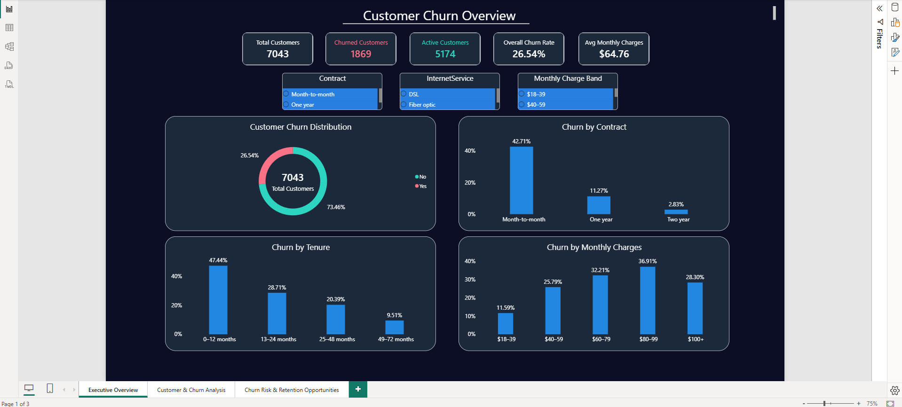
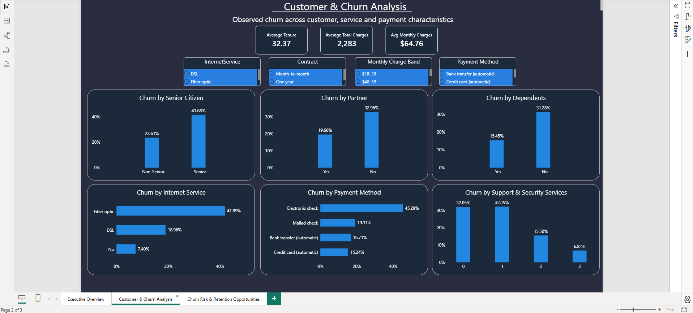
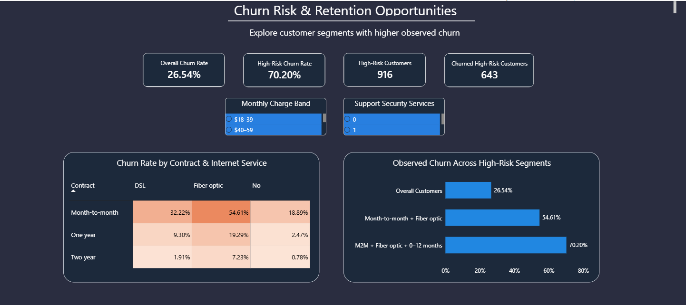

# Telco Customer Churn Analysis | SQL & Power BI

An end-to-end customer churn analysis project using **MySQL and Power BI** to explore churn patterns, understand customer behavior, identify high-risk customer segments, and highlight retention opportunities.

## 📌 Project Overview

Customer churn is an important challenge for subscription-based businesses. This project analyzes customer demographics, contract types, tenure, internet services, billing, and payment methods to understand how these factors are associated with observed churn.

The project combines SQL-based analysis with an interactive Power BI dashboard to translate customer data into actionable business insights.

**Tools & Technologies:** MySQL 8.0 · Power BI · DAX · Power Query · SQL

## 🎯 Business Objectives

- Measure overall customer churn and customer retention.
- Compare churn across contract types and tenure groups.
- Identify customer profiles and services associated with higher churn.
- Analyze billing and payment patterns among churned customers.
- Identify high-risk customer segments and potential retention opportunities.

## 📊 Power BI Dashboard

### Page 1 — Customer Churn Overview

Provides an executive-level overview of customer churn, including key performance indicators, churn distribution, contract type, tenure, and monthly charge patterns.

<p align="center">
  
</p>

### Page 2 — Customer & Churn Analysis

Explores churn across customer demographics, internet services, payment methods, and additional support and security services.

<p align="center">
  
</p>

### Page 3 — Churn Risk & Retention Opportunities

Highlights a high-risk customer segment and compares churn patterns across contract and internet service combinations.

<p align="center">
  
</p>

## 📈 Key Findings

- **Observed churn rate:** 26.54% in the Power BI dataset.
- **Month-to-month contracts:** Show a substantially higher churn rate than longer-term contracts.
- **Short-tenure customers:** Customers in their first 12 months show higher observed churn than longer-tenure groups.
- **Internet service:** Fiber optic customers show higher observed churn than DSL and customers without internet service.
- **Payment method:** Electronic-check customers show a higher observed churn rate than the other payment groups.
- **High-risk segment:** Customers with month-to-month contracts, fiber optic internet, and tenure of 12 months or less have a 70.20% observed churn rate in the SQL analysis.

These are descriptive findings from the available dataset. They indicate associations, not proof that any single factor causes churn.

## 💡 Retention Opportunities

Based on the observed patterns, the business could consider:

1. **Early-tenure engagement:** Improve onboarding and proactively contact new customers who show signs of disengagement.
2. **Contract conversion:** Test suitable incentives for month-to-month customers to move to longer-term contracts.
3. **High-risk customer outreach:** Prioritize support and retention campaigns for the identified high-risk segment.
4. **Payment experience review:** Investigate the customer experience around electronic-check payments.
5. **Service experience monitoring:** Explore service quality, support requests, and customer feedback among higher-churn groups.

These are recommendations to test and evaluate, not guaranteed outcomes.

## 🗂️ Repository Structure

```text
telco-customer-churn-analysis/
├── README.md
├── sql/
├── PowerBI/
├── Dataset/
├── Documentation/
└── Screenshots/
```

- **sql/** — SQL queries for validation and customer churn analysis.
- **PowerBI/** — Power BI report file (`.pbix`).
- **Dataset/** — Dataset access instructions and source information.
- **Documentation/** — - Detailed analysis notes: [`Churned_Cust_project_notes.md`](Documentation/Churned_Cust_project_notes.md)
- **Screenshots/** — Dashboard screenshots displayed in this README.

## 🔍 Data Validation & Methodology

- Checked customer record counts and customer ID uniqueness.
- Reviewed missing or blank values and validated important data types and categories.
- Used SQL to analyze customer churn, tenure, contract types, services, billing, and high-risk segments.
- Used Power BI to summarize customer KPIs and visualize churn patterns.
- Treated churn as an observed outcome in the supplied customer dataset; this project does not forecast future churn.

### Data consistency note

The Power BI report contains **7,043 customer records**, while the MySQL analysis table contains **7,032 records**. The SQL table has 11 fewer records, so SQL and Power BI results may differ.

The Power BI overview reports 1,869 churned customers and a 26.54% churn rate. The MySQL analysis also reports 1,869 churned customers, but its total row count differs. Results from the two environments should therefore be interpreted separately until the source discrepancy is reconciled.

## 📁 Project Files

- SQL analysis scripts: [`sql/`](sql/)
- Power BI report: [`PowerBI/`](PowerBI/)
- Dataset information: [`Dataset/README.md`](Dataset/README.md)
- Detailed analysis notes: [`Documentation/Project_2_notes.md`](Documentation/Project_2_notes.md)
- Dashboard screenshots: [`Screenshots/`](Screenshots/)

## 👩‍💻 Skills Demonstrated

- SQL querying and data validation
- Customer churn and segmentation analysis
- KPI calculation and business interpretation
- Power BI dashboard design
- DAX and data modeling
- Translating analytical findings into retention recommendations

---

**Project Type:** Data Analytics Portfolio Project  
**Tools:** MySQL, Power BI, DAX, Power Query  
**Focus:** Customer Churn · Customer Segmentation · Retention Opportunities
